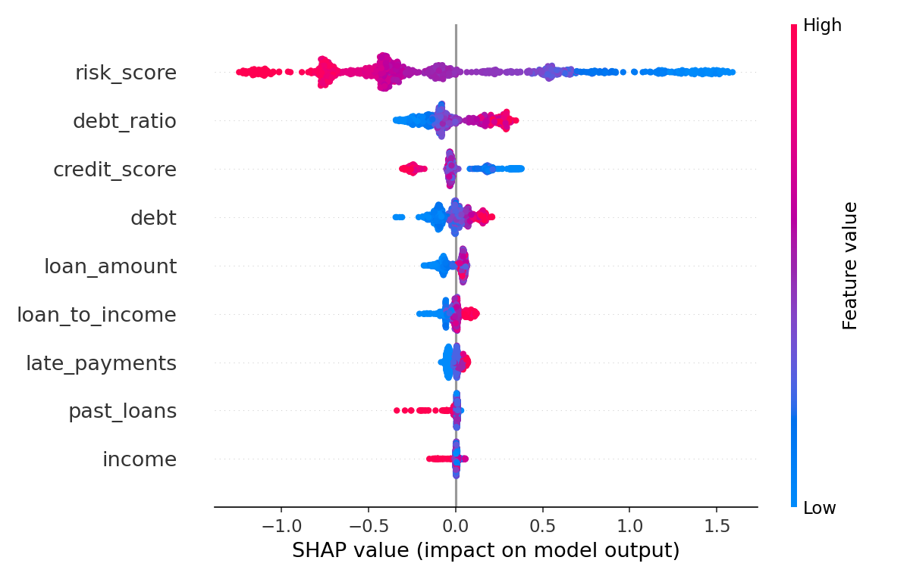

# Loan Default Prediction (XGBoost + SHAP + Streamlit)

Predicts whether a loan applicant is likely to default, explains each prediction with SHAP, and offers a small Streamlit app where a loan officer enters an applicant's details and gets a risk score.

> **Data:** synthetic. `src/data_generator.py` creates 5,000 applicants. Each person's chance of default comes from a probability based on credit score, late payments, debt and loan burden, plus random noise, so the data behaves like real lending data rather than following a fixed rule. For the same kind of model on a real public dataset, see [credit-risk-model](https://github.com/Akshu577/credit-risk-model).

## How it works

1. **Features:** income, credit score, loan amount, debt, late payments and past loans, plus three engineered ones: `debt_ratio`, `loan_to_income` and `risk_score`.
2. **Split 60/20/20** into train, validation and test. The validation set is used for early stopping and for picking the decision threshold, so the test set is only used once, for the final score.
3. **XGBoost** with `scale_pos_weight` = (non-defaults / defaults), so the model pays enough attention to the default class (35% of applicants).
4. **Threshold:** I picked the cutoff with the best F1 on the validation set (0.45) instead of using the default 0.5.
5. **SHAP** shows which features push each prediction up or down.

## Results (test set, 1,000 applicants)

| Metric | Value |
|---|---|
| ROC-AUC | 0.766 |
| Recall (defaults caught) | 72% |
| Precision (flagged applicants who really defaulted) | 57% |
| Accuracy | 71.5% |

For a bank, missing a defaulter usually costs more than double-checking a good applicant, so I chose a threshold that favours recall.



`risk_score` (credit score adjusted for late payments) is by far the strongest driver. A high debt ratio and a high loan-to-income ratio push risk up, and a longer history of past loans pushes it slightly down.

## Run it

```bash
pip install -r requirements.txt
python main.py          # generate data, train, evaluate, save model + SHAP plot
streamlit run app.py    # open the risk checker in your browser
```

On a Mac, XGBoost also needs `brew install libomp`.

## Project structure

```
main.py               training pipeline
app.py                Streamlit risk checker
src/data_generator.py synthetic applicant data
src/preprocess.py     feature engineering
src/train.py          XGBoost training with early stopping
src/evaluate.py       threshold selection and test metrics
images/               SHAP plot
```
